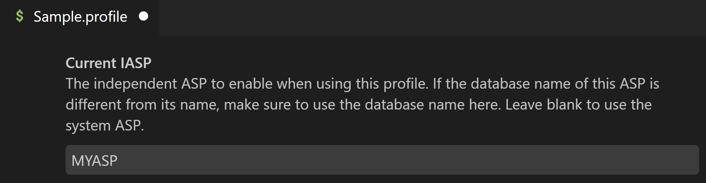

import { Aside } from '@astrojs/starlight/components';

If you store your source code, or objects, in another iASP other than *SYSBAS, there are two ways to configure which iASP is used when working with Code for IBM i.

1. Configure your user profile with a job description that has the ASP set to the iASP you want to use.

   * Set the `INLASPGRP` parameter in [`CRTJOBD`](https://www.ibm.com/docs/i/7.3.0?topic=ssw_ibm_i_73/cl/crtjobd.html) or `CHGJOBD` to the ASP group you want to use.
   * If needed, set which job description to use in your user profile by changing the `JOBD` parameter in [`CHGUSRPRF`](https://www.ibm.com/docs/i/7.3.0?topic=ssw_ibm_i_73/cl/chgusrprf.html).

   <Aside type="tip">
   Some people prefer having a user profile for each ASP.
   </Aside>

2. Create a [Profile](../../environment/profiles/) and configure its **Current iASP**. When that profile is activated, Code for IBM i will switch to the specified iASP automatically.

   

<Aside type="note">
The configuration above only applies to the SQL job used internally by Code for IBM i. For any SQL jobs in the Db2 for i extension, the iASP is configured separately using the [connection properties for that job](../../extensions/db2i/#editing-job-configuration).
</Aside>
